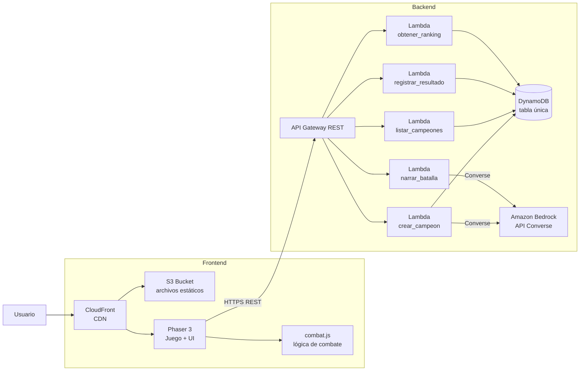

# Design Document — Cloudborn Legends

## Overview

Cloudborn Legends es un juego web serverless en AWS orientado a una demo en vivo y a un portafolio de desarrollador. Un jugador describe un campeón en texto libre y la IA (Amazon Bedrock) lo materializa como un objeto JSON con nombre, estadísticas, habilidades y colores. Dos campeones se enfrentan en una arena con vista desde arriba (estilo MOBA) mediante combate automático en tiempo real: los campeones se mueven y usan habilidades por sí solos según sus estadísticas. Al terminar la batalla, un narrador de IA comenta lo ocurrido y un ranking en vivo llamado "Salón de las Leyendas" muestra a los mejores campeones ordenados por victorias.

El diseño prioriza **simplicidad y estabilidad** sobre funcionalidad avanzada. Las decisiones clave son:

- **Una sola tabla DynamoDB** que almacena campeones y su conteo de victorias en el mismo registro.
- **Una Lambda en Python por endpoint** (5 Lambdas, una responsabilidad cada una).
- **Lógica de combate en un módulo JavaScript separado de Phaser**, de forma que se pueda probar de forma aislada sin cargar el juego en el navegador.
- **Bedrock con la API Converse** (`converse`, sin streaming), con el modelo configurable vía un parámetro de SAM (por defecto Amazon Nova Micro).
- **Código comentado en español** en todo el proyecto.

El frontend es estático (Phaser 3 + JavaScript), servido desde S3 y distribuido por CloudFront. El backend usa API Gateway REST con Lambdas en Python. Toda la infraestructura se define con AWS SAM y se despliega con un único script.

## Architecture

El sistema tiene dos capas claramente separadas: el **Frontend** (contenido estático servido desde S3 + CloudFront) y el **Backend** (API Gateway + Lambdas en Python + DynamoDB + Bedrock). La comunicación entre ambas ocurre únicamente vía los 5 endpoints REST expuestos por API Gateway.



**Flujo principal:**

1. El jugador carga el juego desde CloudFront, que sirve los archivos estáticos desde S3.
2. El jugador describe un campeón; el frontend envía la descripción a `POST /campeones`. La Lambda `crear_campeon` invoca Bedrock (Converse) para generar el campeón, lo valida, lo guarda en DynamoDB con `victorias = 0` y lo devuelve.
3. El jugador elige dos campeones; el frontend inicia el combate usando el módulo `combat.js` (puro, sin Phaser) y Phaser solo renderiza el estado que `combat.js` produce.
4. Al terminar el combate, el frontend envía el resultado a `POST /resultados`. La Lambda `registrar_resultado` incrementa el conteo de victorias del ganador en DynamoDB (o no hace nada si hay empate).
5. El frontend solicita la narración a `POST /narraciones`. La Lambda `narrar_batalla` invoca Bedrock (Converse) y devuelve el comentario narrativo, o una narración de respaldo si Bedrock falla (HTTP 200 con indicador de respaldo).
6. El frontend consulta el ranking con `GET /ranking`. La Lambda `obtener_ranking` lee DynamoDB y devuelve los campeones ordenados por victorias.
7. El frontend lista campeones disponibles con `GET /campeones` para elegir oponentes.

**Restricciones de la arquitectura:**

- Bedrock solo se invoca desde dos Lambdas: `crear_campeon` y `narrar_batalla` (Requirement 16.4). Los permisos IAM de invocación de Bedrock se otorgan únicamente a esas dos Lambdas.
- DynamoDB es el único almacén de datos persistente (Requirement 15.6).
- No hay instancias de servidor que requieran gestión (Requirement 15.5).

## Components and Interfaces

### Componentes del Frontend

El frontend es una aplicación JavaScript servida como contenido estático. Usa Phaser 3 para el renderizado visual y un módulo de combate independiente para la lógica pura del combate.

#### Módulo `combat.js` (lógica de combate pura)

Este es el componente central del diseño desde el punto de vista de testabilidad. Contiene **toda la lógica del combate automático** sin ninguna dependencia de Phaser ni del DOM. Es un módulo de funciones puras (o con estado explícito y determinista) que puede importarse y ejecutarse en Node.js para pruebas unitarias y de propiedades.

**Responsabilidades del módulo:**

- Inicializar el estado del combate a partir de dos campeones y la configuración de la arena.
- Avanzar la simulación tick a tick (movimiento, uso de habilidades, cálculo de daño).
- Registrar eventos relevantes para el narrador (cada ataque, curación, escudo, etc.).
- Determinar el ganador o empate según las reglas de victoria.
- Respetar la duración máxima de 90 segundos.

**Interfaz pública del módulo (funciones principales):**

```javascript
// Crea el estado inicial del combate a partir de dos campeones válidos.
// El parámetro 'semilla' permite que el combate sea determinista y reproducible.
function crearCombate(campeonA, campeonB, configArena, semilla) -> EstadoCombate

// Avanza la simulación un tick (deltaTiempo en segundos).
// Devuelve el nuevo estado y la lista de eventos generados en este tick.
function actualizarTick(estado, deltaTiempo) -> { estado, eventos }

// Calcula el daño final que un atacante inflige a un defensor con una habilidad dada.
// Considera la armadura del defensor y el tipo de habilidad.
function calcularDano(atacante, defensor, habilidad) -> numero

// Selecciona la habilidad que un campeón usará en este tick según su estado y el del oponente.
function seleccionarHabilidad(campeon, estado) -> habilidad | null

// Mueve un campeón hacia su objetivo según su velocidad y el delta de tiempo.
function moverCampeon(campeon, objetivo, deltaTiempo) -> posicion

// Determina el resultado del combate (ganador, empate, o 'en curso').
function determinarGanador(estado) -> { resultado: 'ganador'|'empate'|'en_curso', idGanador }

// Ejecuta la simulación completa hasta que termine y devuelve el resultado + todos los eventos.
// Usada principalmente para pruebas; Phaser usa actualizarTick tick a tick para renderizar.
function simularCombate(campeonA, campeonB, configArena, semilla) -> { resultado, eventos, estadoFinal }
```

**Por qué separar `combat.js` de Phaser:**

- Permite probar la lógica de combate en Node.js con Vitest/Jest sin necesidad de un navegador ni de cargar Phaser.
- Phaser se limita a leer el estado que `combat.js` produce y dibujarlo (sprites, arena, barras de vida, efectos visuales).
- La misma lógica sirve tanto para la simulación visible en el juego como para una simulación rápida "en background" si se desea.
- Facilita las pruebas de propiedades (PBT) sobre invariants como HP en rango, resultado único y determinismo con semilla.

#### Juego Phaser 3

Phaser 3 se encarga exclusivamente del renderizado y la interacción visual. **No contiene lógica de combate**: llama a `combat.js` para avanzar el estado y luego dibuja el resultado.

**Responsabilidades de Phaser:**

- Renderizar la arena vista desde arriba (estilo MOBA) con sprites para los campeones.
- Mostrar las barras de vida de cada campeón, actualizadas al menos cada 1 segundo (Requirement 6.4).
- Llamar a `combat.js.actualizarTick` en cada frame y dibujar las posiciones y efectos resultantes.
- Mostrar los efectos visuales de las habilidades (proyectil, escudo, curación, embestida, área de daño).
- Al terminar el combate, mostrar el resultado y disparar el flujo de narración y registro de resultado.

**Escenas de Phaser:**

- `BootScene`: carga inicial y configuración del juego.
- `InvocacionScene`: pantalla de invocación donde el jugador describe su campeón (texto "Invoca tu leyenda", campo `<textarea>` HTML de 10-500 caracteres con contador visible "X / 500", botón HTML de invocación, mensaje "Tu leyenda está naciendo en la nube...").
- `SeleccionScene` (NUEVA): lista los campeones disponibles llamando a `GET /campeones` y permite al jugador elegir dos campeones para el combate. Muestra cada campeón con su nombre, estadísticas y colores. El jugador selecciona dos (uno y dos, en ese orden) y al confirmar pasa a `ArenaScene`.
- `ArenaScene`: la arena de combate; orquesta el combate llamando a `combat.js` y renderiza el estado.
- `RankingScene`: el Salón de las Leyendas; muestra el ranking ordenado por victorias.

**Flujo entre escenas:** `BootScene` → `InvocacionScene` → `SeleccionScene` → `ArenaScene` → (narración) → `RankingScene` (o volver a `SeleccionScene`).

#### UI del Frontend

- **Pantalla de invocación**: el campo de descripción NO es un objeto de Phaser, sino un elemento `<textarea>` HTML superpuesto (overlay) encima del canvas de Phaser, posicionado con CSS absoluto (`position: absolute`) y un `z-index` superior al del canvas para que quede por encima y sea accesible. Incluye un **contador de caracteres visible** con el formato "X / 500" que se actualiza en tiempo real con JavaScript del navegador a medida que el jugador escribe. El botón de invocar también es un elemento HTML (no de Phaser). Phaser sigue encargándose de la arena y el ranking, pero la pantalla de invocación usa elementos HTML superpuestos para el input, lo que resulta más accesible y simple que un input propio de Phaser. Campo de 10-500 caracteres, mensaje de carga "Tu leyenda está naciendo en la nube..." y visualización del campeón generado (nombre, estadísticas, habilidades, colores). Mensajes de error en español.
- **Arena**: dos campeones con barras de vida, vista superior, efectos de habilidades. Responsive: controles táctiles (área mínima 44x44px) en móvil, controles de cursor/teclado en pantallas grandes.
- **Ranking**: lista de campeones ordenada por victorias descendente, con desempate alfabético ascendente. Texto mínimo 16px en móvil.

### Componentes del Backend

El backend consta de 5 funciones Lambda en Python, una por endpoint. Cada Lambda tiene una única responsabilidad y permisos IAM mínimos.

#### Lambda `crear_campeon` (POST /campeones)

- **Responsabilidad**: recibir una descripción de texto, invocar Bedrock (Converse) para generar un campeón en JSON, validarlo y ajustarlo (Requirement 4), guardarlo en DynamoDB con un identificador único y `victorias = 0`, y devolverlo.
- **Permisos IAM**: escritura en DynamoDB (`PutItem`) + invocación de Bedrock.
- **Validaciones previas a Bedrock**: la descripción debe tener entre 10 y 500 caracteres (después de quitar espacios al inicio y al final). Si no, rechaza con HTTP 400 sin invocar Bedrock.
- **Timeout**: 15 segundos en la definición de SAM; la invocación a Bedrock usa un cliente boto3 con `read_timeout=12`, `connect_timeout=3` y `retries={"max_attempts": 1}` (límite end-to-end de 15 segundos, Requirement 19.1).
- **Manejo de errores de Bedrock**: si Bedrock falla, no responde en 12s, o devuelve un JSON inválido, devuelve un error sin almacenar un campeón parcial (Requirement 3.7, 3.8).

#### Lambda `listar_campeones` (GET /campeones)

- **Responsabilidad**: leer todos los campeones de DynamoDB y devolverlos como un arreglo JSON.
- **Permisos IAM**: lectura en DynamoDB (`Scan`).
- **Comportamiento**: devuelve HTTP 200 con el arreglo (vacío si no hay campeones). Timeout de Lambda de 10 segundos en SAM; el cliente boto3 de DynamoDB usa `read_timeout=5`, `connect_timeout=3`. Si DynamoDB excede 5s, HTTP 500.

#### Lambda `registrar_resultado` (POST /resultados)

- **Responsabilidad**: recibir el resultado de una batalla (ids de los dos campeones y el resultado: ganador o empate), e incrementar en 1 el conteo de victorias del ganador en DynamoDB. Si hay empate, no modifica nada.
- **Permisos IAM**: lectura y actualización en DynamoDB (`GetItem`, `UpdateItem`).
- **Validaciones**: verifica que el resultado incluya ambos ids y el indicador de resultado; que el id del ganador corresponda a uno de los dos participantes y exista en DynamoDB. Cualquier error devuelve HTTP 400 sin modificar conteos.
- **Timeout**: 10 segundos en la definición de SAM; el cliente boto3 de DynamoDB usa `read_timeout=5`, `connect_timeout=3`.

#### Lambda `obtener_ranking` (GET /ranking)

- **Responsabilidad**: leer los campeones de DynamoDB, ordenarlos por victorias descendente y por nombre ascendente en caso de empate, y devolver un máximo de 100 entradas.
- **Permisos IAM**: lectura en DynamoDB (`Scan`).
- **Comportamiento**: devuelve HTTP 200 con el ranking ordenado (vacío si no hay campeones). Timeout de Lambda de 10 segundos en SAM; el cliente boto3 de DynamoDB usa `read_timeout=5`, `connect_timeout=3`. Si DynamoDB no está disponible, devuelve un error indicando que el ranking no está disponible.

#### Lambda `narrar_batalla` (POST /narraciones)

- **Responsabilidad**: recibir los datos de una batalla finalizada (resultado, campeones participantes, eventos registrados), invocar Bedrock (Converse) para generar un comentario narrativo, y devolverlo.
- **Permisos IAM**: invocación de Bedrock. (No necesita DynamoDB.)
- **Timeout**: 15 segundos en la definición de SAM; la invocación a Bedrock usa un cliente boto3 con `read_timeout=12`, `connect_timeout=3` y `retries={"max_attempts": 1}` (límite end-to-end de 15 segundos, Requirement 19.2).
- **Manejo de errores de Bedrock**: si Bedrock falla, no responde en 12s, o devuelve un texto fuera del rango 100-500 caracteres, devuelve **HTTP 200 con una narración de respaldo** en español (100-500 caracteres) que indica el resultado de la batalla, más un indicador `usadoRespaldo: true` (Requirement 14.3).
- **Validaciones**: si los datos de batalla están vacíos o no contienen el resultado, devuelve HTTP 400.

### Diseño de la API

API Gateway expone 5 endpoints REST. Todas las respuestas de error incluyen un mensaje en español en el cuerpo.

#### Endpoint 1: Crear campeón

| Aspecto | Detalle |
|---|---|
| Método | `POST` |
| Ruta | `/campeones` |
| Request body | `{ "descripcion": "<texto de 10 a 500 caracteres>" }` |
| Response 200 | `{ "id": "<uuid>", "nombre": "...", "descripcion": "...", "estadisticas": { "vida": 1000, "dano": 100, "velocidad": 300, "armadura": 30 }, "habilidades": ["proyectil", "curacion"], "colorPrincipal": "#ff0000", "colorSecundario": "#00ff00", "victorias": 0 }` |
| Response 400 | `{ "error": "<mensaje en español>" }` — descripción vacía, solo espacios, o longitud fuera de 10-500 |
| Response 500 | `{ "error": "<mensaje en español>" }` — Bedrock falla o timeout, campeón inválido |

#### Endpoint 2: Listar campeones

| Aspecto | Detalle |
|---|---|
| Método | `GET` |
| Ruta | `/campeones` |
| Request body | (ninguno) |
| Response 200 | `[ { ...campeón... }, ... ]` — arreglo con todos los campeones (vacío si no hay) |
| Response 500 | `{ "error": "El servicio no está disponible" }` — DynamoDB no responde en 5s |

#### Endpoint 3: Registrar resultado

| Aspecto | Detalle |
|---|---|
| Método | `POST` |
| Ruta | `/resultados` |
| Request body | `{ "campeonA": "<id>", "campeonB": "<id>", "resultado": "ganador", "idGanador": "<id>" }` o `{ "campeonA": "<id>", "campeonB": "<id>", "resultado": "empate" }` |
| Response 200 | `{ "ok": true }` |
| Response 400 | `{ "error": "<mensaje en español>" }` — ids faltantes, idGanador inválido, o campeón no existe |

#### Endpoint 4: Obtener ranking

| Aspecto | Detalle |
|---|---|
| Método | `GET` |
| Ruta | `/ranking` |
| Request body | (ninguno) |
| Response 200 | `[ { "id": "...", "nombre": "...", "victorias": 5, ... }, ... ]` — máximo 100, ordenado por victorias desc y nombre asc |
| Response 500 | `{ "error": "El ranking no está disponible" }` — DynamoDB no disponible |

#### Endpoint 5: Narrar batalla

| Aspecto | Detalle |
|---|---|
| Método | `POST` |
| Ruta | `/narraciones` |
| Request body | `{ "campeonA": { ...campeón... }, "campeonB": { ...campeón... }, "resultado": "ganador", "idGanador": "<id>", "eventos": [ ... ] }` |
| Response 200 | `{ "narracion": "<texto en español 100-500 caracteres>", "usadoRespaldo": false }` o `{ "narracion": "<narración de respaldo>", "usadoRespaldo": true }` |
| Response 400 | `{ "error": "<mensaje en español>" }` — datos de batalla vacíos o sin resultado |

El campo `eventos` contiene **máximo 15 eventos relevantes** seleccionados por el frontend antes de llamar a este endpoint. El frontend NO envía todos los eventos del combate: filtra y prioriza en este orden hasta alcanzar 15:

1. Muerte de un campeón (`tipo: 'muerte'`)
2. Tiempo agotado (`tipo: 'tiempo_agotado'`)
3. Habilidades especiales usadas (`tipo: 'embestida'`, `'escudo'`, `'curacion'`, `'area'`)
4. Proyectiles (`tipo: 'ataque'` con habilidad proyectil)
5. Golpes mayores (`tipo: 'ataque'` con daño > 80)

De la lista completa de eventos del combate, el frontend selecciona hasta 15 manteniendo el orden cronológico y usando la prioridad anterior para descartar cuando hay más de 15. Si hay menos de 15 eventos relevantes, envía todos.

## Data Models

Se usa **una sola tabla** llamada `CloudbornLegendsTable`. Cada item representa un campeón e incluye sus datos completos y su contador de victorias en el mismo registro. No hay tablas separadas para campeones y ranking: el ranking se deriva de la misma tabla ordenando por el atributo `victorias`.

### Esquema de la tabla

| Atributo | Tipo | Clave | Descripción |
|---|---|---|---|
| `PK` | String | **Partition Key** | `CAMPEON#<uuid>` — clave de partición fija para todo campeón |
| `id` | String | | Identificador único del campeón (UUID generado al crearlo) |
| `nombre` | String | | Nombre del campeón (1-30 caracteres) |
| `descripcion` | String | | Descripción original del jugador (10-500 caracteres) |
| `estadisticas` | Map | | `{ vida, dano, velocidad, armadura }` — valores dentro de rangos fijos |
| `habilidades` | List(String) | | Entre 2 y 3 habilidades del catálogo predefinido, sin duplicados |
| `colorPrincipal` | String | | Color principal (hex) |
| `colorSecundario` | String | | Color secundario (hex) |
| `victorias` | Number | | Conteo de victorias (inicia en 0; se incrementa con `ADD`) |
| `createdAt` | String | | Marca temporal ISO 8601 de creación |

### Rangos fijos de estadísticas

| Estadística | Rango |
|---|---|
| vida | 800 - 1200 |
| daño (dano) | 50 - 150 |
| velocidad | 200 - 400 |
| armadura | 10 - 50 |

### Catálogo predefinido de habilidades

`proyectil`, `escudo`, `curacion`, `embestida`, `area_de_dano` (cinco habilidades, inmutable).

### Ejemplo de item

```json
{
  "PK": "CAMPEON#a1b2c3d4-e5f6-7890-abcd-ef1234567890",
  "id": "a1b2c3d4-e5f6-7890-abcd-ef1234567890",
  "nombre": "Pyron el Ardiente",
  "descripcion": "Un guerrero de fuego que domina las llamas...",
  "estadisticas": {
    "vida": 1050,
    "dano": 120,
    "velocidad": 310,
    "armadura": 25
  },
  "habilidades": ["proyectil", "curacion", "embestida"],
  "colorPrincipal": "#ff4500",
  "colorSecundario": "#ffd700",
  "victorias": 3,
  "createdAt": "2025-01-15T12:00:00Z"
}
```

### Patrones de acceso

| Operación | Lambda | Operación DynamoDB | Notas |
|---|---|---|---|
| Crear campeón | `crear_campeon` | `PutItem` | Escribe el item completo con `victorias = 0` |
| Listar campeones | `listar_campeones` | `Scan` | Devuelve todos los items |
| Registrar resultado | `registrar_resultado` | `UpdateItem` (ADD) | `ADD victorias :1` sobre el item del ganador; en empate no hace nada |
| Obtener ranking | `obtener_ranking` | `Scan` | Lee todos los items y los ordena en la Lambda por `victorias` desc y `nombre` asc, límite 100 |
| Verificar existencia | `registrar_resultado` | `GetItem` | Verifica que el id del ganador exista |

**Decisión sobre el ranking:** Para una demo con bajo volumen de campeones, un `Scan` + ordenamiento en la Lambda es lo más simple y suficiente. Se menciona en la sección de Trade-offs que un GSI con `victorias` como sort key sería la optimización natural si el volumen creciera, pero no se implementa para mantener la simplicidad.

## Integración con Bedrock

Las Lambdas `crear_campeon` y `narrar_batalla` son las únicas que invocan Bedrock, y ambas usan la **API Converse** (`converse`, sin streaming), no la API de modelos específicos (`invoke_model`). Se usa **solamente `converse`** (no `converse_stream`) porque la generación es corta y no se necesita streaming para una demo simple.

### Modelo configurable

El modelo de Bedrock se configura mediante un parámetro de SAM `BedrockModelId`, con valor por defecto `amazon.nova-micro-v1:0` (Amazon Nova Micro, bajo costo). Esto permite cambiar el modelo sin modificar el código (Requirement 3.6). El parámetro se pasa a las Lambdas como variable de entorno `BEDROCK_MODEL_ID`.

### Invocación con Converse

**Patrón general de uso de la API Converse:**

```python
# Pseudocódigo de la invocación con Converse (crear_campeon)
import boto3, json

bedrock = boto3.client('bedrock-runtime')
model_id = os.environ['BEDROCK_MODEL_ID']

respuesta = bedrock.converse(
    modelId=model_id,
    messages=[
        {
            "role": "user",
            "content": [{"text": prompt_usuario}]
        }
    ],
    system=[{"text": prompt_sistema}],
    inferenceConfig={
        "maxTokens": 800,
        "temperature": 0.7
    }
)
texto_generado = respuesta['output']['message']['content'][0]['text']
```

### Generación de campeón (Lambda `crear_campeon`)

**System message (prompt de sistema):**

> Eres un generador de campeones para un juego de arena. A partir de la descripción del jugador, genera un campeón en formato JSON. El JSON debe contener: un "nombre" de entre 1 y 30 caracteres, "estadisticas" con cuatro valores (vida entre 800 y 1200, dano entre 50 y 150, velocidad entre 200 y 400, armadura entre 10 y 50), "habilidades" como un arreglo de entre 2 y 3 elementos del catálogo ["proyectil", "escudo", "curacion", "embestida", "area_de_dano"] sin duplicados, "colorPrincipal" y "colorSecundario" como colores hex. Devuelve únicamente el JSON válido, sin texto adicional.

**User message:**

> Descripción del campeón: `<descripción del jugador>`

**Formato JSON esperado de Bedrock:**

```json
{
  "nombre": "...",
  "estadisticas": { "vida": 1000, "dano": 100, "velocidad": 300, "armadura": 30 },
  "habilidades": ["proyectil", "escudo"],
  "colorPrincipal": "#ff0000",
  "colorSecundario": "#0000ff"
}
```

**Flujo:**

1. La Lambda recibe la descripción, valida longitud (10-500 caracteres tras trim).
2. Construye el prompt y llama a `bedrock.converse(...)` con timeout de 12 segundos.
3. Extrae el texto de la respuesta y lo parsea como JSON.
4. Valida y ajusta el campeón según el Requirement 4 (clamp de estadísticas, verificación de estructura y habilidades).
5. Si todo es válido, genera un UUID, asigna `victorias = 0`, guarda en DynamoDB y devuelve el campeón.
6. Si Bedrock falla, timeout, o el JSON no cumple la estructura, devuelve un error sin almacenar nada parcial.

### Narración de batalla (Lambda `narrar_batalla`)

**System message:**

> Eres el narrador de un juego de arena de combate. Recibirás el resultado de una batalla entre dos campeones y una lista de eventos. Genera un comentario narrativo en español de entre 100 y 500 caracteres que mencione el resultado de la batalla y al menos un evento ocurrido. Devuelve únicamente el texto narrativo, sin formato JSON.

**User message:**

> Resultado: `<ganador o empate>`. Campeón A: `<nombre>`. Campeón B: `<nombre>`. Eventos: `<lista de eventos>`.

**Flujo:**

1. La Lambda recibe los datos de la batalla (resultado, campeones, eventos).
2. Valida que los datos no estén vacíos y contengan el resultado (si no, HTTP 400).
3. Construye el prompt y llama a `bedrock.converse(...)` con timeout de 12 segundos.
4. Extrae el texto y verifica que tenga entre 100 y 500 caracteres.
5. Si Bedrock responde correctamente y el texto cumple el rango, devuelve `{ "narracion": texto, "usadoRespaldo": false }` con HTTP 200.
6. Si Bedrock falla, timeout, o el texto está fuera de rango, construye una **narración de respaldo** en español de 100-500 caracteres que indica el resultado, y devuelve `{ "narracion": respaldo, "usadoRespaldo": true }` con HTTP 200.

### Narración de respaldo

La narración de respaldo se construye con una plantilla que incluye los nombres de los campeones y el resultado. Ejemplo:

> La batalla entre `<nombreA>` y `<nombreB>` ha terminado. `<ganador>` se alzó con la victoria tras una intensa lucha en la arena. Los campeones demostraron su valor y el público coreó sus nombres. Una leyenda más se escribe en el Salón de las Leyendas.

La plantilla garantiza que el texto resultante esté dentro del rango 100-500 caracteres. Si los nombres son muy largos, se truncan para respetar el límite superior.

## Lógica de combate

El combate es automático y se ejecuta en el módulo `combat.js`. Es determinista dada una semilla, lo que lo hace reproducible y testeable.

### Estructura del estado de combate

```javascript
// EstadoCombate
{
  campeonA: { ...campeon, hp: vida_maxima, posicion: {x, y}, enfriamientos: {...}, escudoActivo: false, escudoTurnos: 0 },
  campeonB: { ...campeon, hp: vida_maxima, posicion: {x, y}, enfriamientos: {...}, escudoActivo: false, escudoTurnos: 0 },
  tiempoTranscurrido: 0,        // segundos
  duracionMaxima: 90,          // segundos
  arena: { ancho: 800, alto: 600 },
  eventos: [],                 // lista de eventos registrados para el narrador
  resultado: null,             // 'ganador' | 'empate' | null
  idGanador: null,
  rng: <generador con semilla>  // para decisiones aleatorias reproducibles
}
```

### Algoritmo de combate (pseudocódigo)

```javascript
// simularCombate: ejecuta la simulación completa
function simularCombate(campeonA, campeonB, configArena, semilla) {
  estado = crearCombate(campeonA, campeonB, configArena, semilla)
  deltaTick = 0.05  // 50 ms por tick (20 ticks/segundo)

  while (estado.resultado === null) {
    { estado, eventos } = actualizarTick(estado, deltaTick)
    estado.eventos.push(...eventos)

    // Condición de fin: vida en cero o tiempo máximo
    if (estado.campeonA.hp <= 0 || estado.campeonB.hp <= 0) {
      estado.resultado = determinarGanador(estado)
    } else if (estado.tiempoTranscurrido >= estado.duracionMaxima) {
      estado.resultado = determinarGanadorPorVida(estado)  // mayor % de vida o empate
    }
  }
  return { resultado: estado.resultado, idGanador: estado.idGanador, eventos: estado.eventos, estadoFinal: estado }
}
```

### Game loop con paso fijo (fixed timestep)

Phaser avanza `combat.js` en pasos fijos de **50 ms** usando un acumulador. Esto garantiza el determinismo del combate independientemente del framerate del navegador:

```javascript
// Patrón de game loop con acumulador (fixed timestep de 50ms)
// Phaser llama a este método en el update de ArenaScene
const PASO_FIJO = 0.05  // 50 ms en segundos

let acumulador = 0

function update(time, delta) {
  // delta es el tiempo en ms desde el último frame (lo provee Phaser)
  acumulador += delta / 1000  // convertir a segundos

  // Avanzar la simulación en pasos fijos mientras haya tiempo acumulado
  while (acumulador >= PASO_FIJO) {
    const { nuevoEstado, eventos } = combat.actualizarTick(estadoCombate, PASO_FIJO)
    estadoCombate = nuevoEstado
    eventosNarracion.push(...eventos)
    acumulador -= PASO_FIJO
  }

  // Phaser dibuja el estado actual (posiciones, HP, efectos)
  renderizar(estadoCombate)
}
```

### Movimiento

```javascript
// moverCampeon: mueve un campeón hacia el oponente según su velocidad
function moverCampeon(campeon, objetivo, deltaTiempo) {
  direccion = normalizar(objetivo.posicion - campeon.posicion)
  distancia = campeon.estadisticas.velocidad * deltaTiempo
  // La velocidad de Phaser (px/s) se mapea desde la estadística (200-400)
  nuevaPosicion = campeon.posicion + direccion * distancia
  return limitarALaArena(nuevaPosicion, arena)
}
```

La velocidad de la estadística (200-400) se interpreta como píxeles por segundo en la arena. Cada campeón se mueve hacia el oponente hasta estar a rango de ataque.

### Selección de habilidades

```javascript
// seleccionarHabilidad: elige qué habilidad usar según el estado y los enfriamientos
function seleccionarHabilidad(campeon, estado) {
  for (habilidad of campeon.habilidades) {
    if (campeon.enfriamientos[habilidad] <= 0) {
      // Prioridad según el contexto:
      // - Si HP baja y tiene 'curacion', la usa
      // - Si oponente ataca y tiene 'escudo', lo activa
      // - Si oponente a rango y tiene 'proyectil' o 'area_de_dano', ataca
      // - Si oponente cerca, 'embestida'
      return habilidad
    }
  }
  return null  // ataque básico si no hay habilidad disponible
}
```

### Cálculo de daño

```javascript
// calcularDano: daño final considerando armadura y habilidad
function calcularDano(atacante, defensor, habilidad) {
  danoBase = atacante.estadisticas.dano
  multiplicador = multiplicadorPorHabilidad(habilidad)  // proyectil=1.0, embestida=1.5, area=0.8
  danoBruto = danoBase * multiplicador

  // La armadura reduce el daño (fórmula simple de mitigación)
  if (defensor.escudoActivo) {
    danoBruto = danoBruto * 0.5  // escudo reduce 50%
  }
  reduccionArmadura = defensor.estadisticas.armadura / (defensor.estadisticas.armadura + 100)
  danoFinal = danoBruto * (1 - reduccionArmadura)

  return Math.max(0, danoFinal)
}
```

**Tabla de balance de habilidades:**

| Habilidad | Rango de uso | Enfriamiento | Multiplicador / Efecto | Condición especial |
|---|---|---|---|---|
| Ataque básico | 60 px | cada 1 s | ×1.0 | Siempre disponible; se usa cuando el campeón está a rango y no hay habilidades activas |
| Proyectil | 300 px | 3 s | ×1.0 | Ataque a distancia |
| Embestida | 150 px | 6 s | ×1.5 | Carga con bonus de daño |
| Área de daño | 120 px | 7 s | ×0.8 | Daño en área |
| Escudo | — | 10 s | reduce 50% el daño recibido | Dura 3 s; no inflige daño |
| Curación | — | 12 s | cura 12% de la vida máxima | Solo se activa si vida < 50% de la vida máxima |

**Notas de balance:**

- El **ataque básico** se ejecuta automáticamente cada 1 s cuando el campeón está dentro de 60 px del oponente y no tiene habilidades especiales disponibles.
- La **curación** solo se selecciona cuando la vida del campeón está por debajo del 50% de su vida máxima.
- El **escudo** activa una reducción del 50% en el daño recibido durante 3 s.

### Determinación del ganador

```javascript
// determinarGanador: cuando un campeón llega a HP 0
function determinarGanador(estado) {
  aVivo = estado.campeonA.hp > 0
  bVivo = estado.campeonB.hp > 0
  if (!aVivo && !bVivo) return { resultado: 'empate', idGanador: null }
  if (!aVivo) return { resultado: 'ganador', idGanador: estado.campeonB.id }
  if (!bVivo) return { resultado: 'ganador', idGanador: estado.campeonA.id }
  return { resultado: 'en_curso', idGanador: null }
}

// determinarGanadorPorVida: cuando se agotan los 90 segundos
function determinarGanadorPorVida(estado) {
  pctA = estado.campeonA.hp / estado.campeonA.estadisticas.vida
  pctB = estado.campeonB.hp / estado.campeonB.estadisticas.vida
  if (pctA > pctB) return { resultado: 'ganador', idGanador: estado.campeonA.id }
  if (pctB > pctA) return { resultado: 'ganador', idGanador: estado.campeonB.id }
  return { resultado: 'empate', idGanador: null }
}
```

### Registro de eventos para el narrador

Cada acción relevante genera un evento que se acumula en `estado.eventos` y se envía luego a la Lambda de narración:

```javascript
// Formato de evento
{ tipo: 'ataque' | 'curacion' | 'escudo' | 'embestida' | 'area' | 'muerte' | 'tiempo_agotado',
  campeon: '<id>',
  objetivo: '<id>' | null,
  detalle: '<texto breve>' }
```

Ejemplos: `{ tipo: 'ataque', campeon: 'A', objetivo: 'B', detalle: 'proyectil inflige 85 de daño' }`, `{ tipo: 'curacion', campeon: 'B', detalle: 'recupera 120 HP' }`.

### Invariants del combate

- La vida de cada campeón permanece en `[0, vida_maxima]` durante toda la batalla (Requirement 6.7, 7.4). La curación nunca supera la vida máxima.
- El combate involucra exactamente dos campeones (Requirement 6.5).
- El combate produce exactamente un resultado: un ganador único o un empate, nunca ambos ni ninguno (Requirement 7.5).
- La duración máxima es 90 segundos; al expirar, gana el de mayor porcentaje de vida restante o empate si son iguales (Requirement 7.3, 7.6).
- El combate es determinista dada una semilla, lo que permite reproducir resultados en pruebas.

## Infraestructura SAM

Toda la infraestructura se define en `template.yaml` con AWS SAM. Los recursos son:

### Recursos definidos

| Recurso | Tipo SAM/CloudFormation | Descripción |
|---|---|---|
| `CloudbornLegendsTable` | `AWS::DynamoDB::Table` | Tabla única con PK `PK` (String). Atributo `victorias` (Number). Capacidad bajo demanda (`BillingMode: PAY_PER_REQUEST`) |
| `ApiGateway` | `AWS::Serverless::Api` | API Gateway REST con CORS habilitado |
| `CrearCampeonFunction` | `AWS::Serverless::Function` | Lambda en Python (crear_campeon). Permisos: DynamoDB PutItem + Bedrock Invoke |
| `ListarCampeonesFunction` | `AWS::Serverless::Function` | Lambda en Python (listar_campeones). Permisos: DynamoDB Scan |
| `RegistrarResultadoFunction` | `AWS::Serverless::Function` | Lambda en Python (registrar_resultado). Permisos: DynamoDB GetItem + UpdateItem |
| `ObtenerRankingFunction` | `AWS::Serverless::Function` | Lambda en Python (obtener_ranking). Permisos: DynamoDB Scan |
| `NarrarBatallaFunction` | `AWS::Serverless::Function` | Lambda en Python (narrar_batalla). Permisos: Bedrock Invoke |
| `FrontendBucket` | `AWS::S3::Bucket` | Bucket S3 para archivos estáticos del frontend |
| `CloudFrontDistribution` | `AWS::CloudFront::Distribution` | Distribución CDN que apunta al bucket S3 |
| `CloudFrontOriginAccessControl` | `AWS::CloudFront::OriginAccessControl` | Control de acceso para que CloudFront lea del bucket S3 |

### Parámetros configurables

| Parámetro | Valor por defecto | Descripción |
|---|---|---|
| `BedrockModelId` | `amazon.nova-micro-v1:0` | ID del modelo de Bedrock (configurable, por defecto Amazon Nova Micro) |
| `FrontendBucketName` | (generado) | Nombre del bucket S3 del frontend |
| `DynamoDBTableName` | `CloudbornLegendsTable` | Nombre de la tabla DynamoDB |
| `BedrockTimeoutSeconds` | `12` | Timeout de invocación a Bedrock en segundos |
| `EndToEndTimeoutSeconds` | `15` | Límite end-to-end en segundos |

### Roles IAM

- **`CrearCampeonRole`**: permite `dynamodb:PutItem` sobre la tabla + `bedrock:InvokeModel` (la API Converse usa este permiso).
- **`ListarCampeonesRole`**: permite `dynamodb:Scan` sobre la tabla.
- **`RegistrarResultadoRole`**: permite `dynamodb:GetItem` + `dynamodb:UpdateItem` sobre la tabla.
- **`ObtenerRankingRole`**: permite `dynamodb:Scan` sobre la tabla.
- **`NarrarBatallaRole`**: permite `bedrock:InvokeModel`.

Solo `CrearCampeonRole` y `NarrarBatallaRole` tienen permiso de invocación de Bedrock (Requirement 16.4).

### Script de despliegue

El proyecto incluye un **único script de despliegue** (`deploy.ps1` para Windows / `deploy.sh` para Unix) que:

1. Construye y empaqueta la aplicación SAM (`sam build`).
2. Despliega el backend con `sam deploy --guided` (o con parámetros guardados).
3. Lee el output `ApiUrl` del resultado de `sam deploy` vía `aws cloudformation describe-stacks --query Outputs`.
4. **Genera el archivo `frontend/config.js`** con el contenido `window.CONFIG = { apiUrl: "<ApiUrl>" };` — esto conecta el frontend estático con la API desplegada sin hardcodear URLs. El frontend Phaser lee `window.CONFIG.apiUrl` para hacer las llamadas a la API; si `window.CONFIG` no existe (desarrollo local), usa `http://localhost:3000` como valor por defecto.
5. Sube los archivos estáticos (incluido el `config.js` recién generado) al bucket S3.
6. Invalida la caché de CloudFront.

Tras la configuración inicial de credenciales de AWS, no se requieren pasos manuales adicionales (Requirement 17.1).

### Outputs de SAM

El `template.yaml` exporta los siguientes outputs para que el script de despliegue y otros consumidores puedan obtener las URLs sin buscarlas manualmente:

```yaml
# template.yaml — Outputs exportados por SAM
Outputs:
  ApiUrl:
    Description: "URL base de la API Gateway REST"
    Value: !Sub "https://${ApiGateway}.execute-api.${AWS::Region}.amazonaws.com/Prod"
  CloudFrontUrl:
    Description: "URL pública del frontend en CloudFront"
    Value: !Sub "https://${CloudFrontDistribution.DomainName}"
```

### Control de costos

**Throttling en API Gateway**

El stage de API Gateway tiene configurado throttling con `ThrottlingRateLimit: 5` (5 requests/segundo) y `ThrottlingBurstLimit: 10` (burst de 10), suficiente para una demo en vivo con pocos usuarios. Si una solicitud excede el límite, API Gateway devuelve HTTP 429 automáticamente.

**AWS Budgets — alerta de $5 USD**

Se recomienda crear una alerta de AWS Budgets de **$5 USD mensuales** sobre la cuenta AWS. Esta alerta es manual (no se define en SAM) y se configura desde la consola de AWS o con la CLI. Avisa por correo cuando el costo mensual proyectado supera $5, sirviendo como red de seguridad ante invocaciones inesperadas de Bedrock.

Comando de referencia (AWS CLI):

```bash
aws budgets create-budget --account-id <ID_CUENTA> \
  --budget '{"BudgetName":"CloudbornAlerta5","BudgetLimit":{"Amount":"5","Unit":"USD"},"TimeUnit":"MONTHLY","BudgetType":"COST"}' \
  --notifications-with-subscribers '[{"Notification":{"NotificationType":"FORECASTED","ComparisonOperator":"GREATER_THAN","Threshold":100},"Subscribers":[{"SubscriptionType":"EMAIL","Address":"<tu@email.com>"}]}]'
```

**Bedrock y la capa gratuita**

A diferencia de Lambda, DynamoDB y CloudFront, **Amazon Bedrock NO tiene capa gratuita**. Sin embargo, el costo de inferencia con **Amazon Nova Micro** es del orden de centavos por invocación (aproximadamente $0.000035 por 1000 tokens de entrada con Nova Micro a octubre 2025). Para una demo en vivo con pocas decenas de invocaciones, el gasto total por Bedrock es mínimo y manejable con la alerta de Budgets. El modelo configurable (`BedrockModelId`) permite ajustar la calidad/costo según el caso de uso.

## Correctness Properties

*A property is a characteristic or behavior that should hold true across all valid executions of a system-essentially, a formal statement about what the system should do. Properties serve as the bridge between human-readable specifications and machine-verifiable correctness guarantees.*

El feature tiene componentes que son candidatos ideales para property-based testing (PBT): el módulo `combat.js` (lógica pura y determinista), la validación/ajuste de campeones (función pura en Python) y el ordenamiento del ranking (función pura). Las integraciones con servicios externos (Bedrock, DynamoDB) se prueban con mocks para la lógica propia y con tests de integración para el comportamiento del servicio.

### Property 1: Validación de descripción rechaza entradas inválidas sin invocar Bedrock

*For any* descripción de texto cuya longitud (tras quitar espacios al inicio y al final) sea menor a 10, mayor a 500, o compuesta únicamente de espacios en blanco, la validación de la Lambda `crear_campeon` SHALL rechazar la solicitud con HTTP 400 y un mensaje en español, sin invocar Bedrock.

**Validates: Requirements 3.2, 2.5, 10.3, 10.5**

### Property 2: Invariante de estructura del campeón

*For any* campeón generado o validado con éxito, el resultado SHALL contener exactamente: un nombre de entre 1 y 30 caracteres, las cuatro estadísticas, entre 2 y 3 habilidades todas pertenecientes al catálogo predefinido, y dos colores (principal y secundario).

**Validates: Requirements 3.3, 5.2, 5.3, 2.6**

### Property 3: Invariante de rangos de estadísticas

*For any* campeón válido resultante de la validación, las estadísticas SHALL estar dentro de sus rangos fijos: vida ∈ [800, 1200], daño ∈ [50, 150], velocidad ∈ [200, 400], armadura ∈ [10, 50].

**Validates: Requirements 3.5, 4.7**

### Property 4: Ajuste de estadísticas al límite más cercano

*For any* campeón con una estadística fuera de su rango fijo, la validación SHALL ajustar el valor al límite válido más cercano del rango; y *for any* campeón con todas sus estadísticas dentro del rango, la validación SHALL dejar las estadísticas sin cambios.

**Validates: Requirements 4.2, 4.8, 4.5**

### Property 5: Idempotencia de la validación

*For any* campeón válido, validar el campeón dos veces SHALL producir valores idénticos en todos los campos (nombre, estadísticas, habilidades y colores) que validarlo una sola vez.

**Validates: Requirements 4.6**

### Property 6: El ajuste preserva los campos no-estadísticas

*For any* campeón cuyas estadísticas son ajustadas por la validación, los campos distintos a las estadísticas (nombre, habilidades y colores) SHALL permanecer idénticos a los del campeón original.

**Validates: Requirements 4.9**

### Property 7: No duplicidad de habilidades

*For any* campeón válido, las habilidades asignadas SHALL ser distintas entre sí, sin duplicados, y todas pertenecer al catálogo predefinido.

**Validates: Requirements 5.5**

### Property 8: Rechazo de campeones inválidos o incompletos

*For any* JSON de campeón que no cumpla la estructura esperada (nombre ausente, vacío o superior a 30 caracteres; número incorrecto de estadísticas o habilidades; número incorrecto de colores; sintaxis JSON inválida; o una habilidad que no pertenezca al catálogo predefinido), la validación SHALL rechazar el campeón con un error descriptivo y SHALL no emitir ni almacenar un campeón inválido.

**Validates: Requirements 3.8, 4.1, 4.3, 4.4, 5.4, 10.7, 19.4**

### Property 9: Vida dentro de límites durante todo el combate

*For any* combate entre dos campeones, la vida de cada campeón SHALL permanecer mayor o igual a cero y menor o igual a su vida máxima durante toda la batalla, incluyendo después de cada ataque y de cada curación.

**Validates: Requirements 6.7, 7.4**

### Property 10: El combate termina al llegar a vida cero o a 90 segundos

*For any* combate entre dos campeones, el combate SHALL terminar en el momento en que la vida de un campeón llegue a cero o cuando el combate alcance los 90 segundos de duración, lo que ocurra primero.

**Validates: Requirements 6.6, 7.3**

### Property 11: Resultado único y determinación del ganador

*For any* combate entre exactamente dos campeones, el combate SHALL producir exactamente un resultado: cuando un campeón llega a vida cero y el otro tiene vida mayor que cero, el de vida mayor es el ganador; cuando ambos llegan a cero, empate; cuando se alcanzan los 90 segundos, el campeón con mayor porcentaje de vida restante respecto a su vida máxima es el ganador, y si ambos porcentajes son iguales, empate. Nunca se producen a la vez un ganador y un empate, ni se omite el resultado.

**Validates: Requirements 6.5, 7.1, 7.2, 7.5, 7.6**

### Property 12: Determinismo del combate con semilla

*For any* par de campeones, configuración de arena y semilla, ejecutar la simulación del combate dos veces con la misma semilla SHALL producir un resultado idéntico (mismo ganador o empate) y la misma secuencia de eventos.

**Validates: Requirements 6.2, 6.3**

### Property 13: El movimiento es proporcional a la velocidad

*For any* par de campeones A y B donde la velocidad de A es mayor que la velocidad de B, la distancia que A recorre en un tick SHALL ser mayor que la distancia que B recorre en el mismo tick bajo las mismas condiciones.

**Validates: Requirements 6.2, 6.3**

### Property 14: Narración de respaldo válida ante falla de Bedrock

*For any* resultado de batalla donde Bedrock falle, no responda en 12 segundos, o devuelva un texto fuera del rango de 100 a 500 caracteres, la Lambda `narrar_batalla` SHALL devolver HTTP 200 con una narración de respaldo en español de entre 100 y 500 caracteres que incluya el resultado de la batalla, junto con el indicador `usadoRespaldo = true`.

**Validates: Requirements 8.4, 14.3, 14.5, 19.3**

### Property 15: Invariante de orden del ranking

*For any* conjunto de campeones en DynamoDB, el ranking retornado por la Lambda `obtener_ranking` SHALL estar ordenado por número de victorias en orden descendente y, a igualdad de victorias, por nombre en orden ascendente; SHALL contener un máximo de 100 entradas; y ningún campeón SHALL aparecer más de una vez.

**Validates: Requirements 9.1, 9.3, 13.2**

### Property 16: Aislamiento del incremento de victorias

*For any* resultado de batalla registrado con un ganador declarado, exactamente el campeón ganador SHALL incrementar su conteo de victorias en 1 (incluso si no figuraba previamente, iniciando en 1) y el conteo de victorias de todo campeón distinto del ganador SHALL permanecer sin cambios.

**Validates: Requirements 9.2, 9.5, 9.6, 12.2**

### Property 17: El empate no modifica los conteos de victorias

*For any* resultado de batalla registrado con empate, el conteo de victorias de todos los campeones participantes SHALL permanecer sin cambios.

**Validates: Requirements 9.4, 12.3**

### Property 18: Conservación del total de victorias

*For any* estado del ranking, la suma de los conteos de victorias de todos los campeones SHALL ser igual al número de resultados de batalla registrados con un ganador declarado.

**Validates: Requirements 9.7**

### Property 19: Registro de resultado inválido rechazado sin efectos colaterales

*For any* intento de registro de resultado donde falten los identificadores de ambos campeones o el indicador de resultado, o donde el identificador del ganador esté vacío, no corresponda a ninguno de los dos participantes, o no exista en DynamoDB, la Lambda `registrar_resultado` SHALL retornar HTTP 400 con un mensaje en español y SHALL dejar todos los conteos de victorias en su estado anterior al intento.

**Validates: Requirements 12.4, 12.5, 12.6**

### Property 20: Datos de batalla vacíos o sin resultado rechazados

*For any* solicitud de narración que contenga datos de batalla vacíos o que no incluya el resultado del combate, la Lambda `narrar_batalla` SHALL retornar HTTP 400 con un mensaje en español.

**Validates: Requirements 14.4**

## Error Handling

El manejo de errores se diseña para que la demo nunca se bloquee ni pierda el estado de la sesión (Requirement 17.4), y para que los errores se comuniquen al jugador en español.

### Frontend

- **Descripción inválida (vacía, solo espacios, <10 o >500 caracteres)**: el frontend muestra un mensaje de error en español antes de enviar la solicitud, sin iniciar la generación (Requirement 2.5).
- **Generación de campeón fallida**: el frontend muestra un mensaje de error en español, conserva la descripción ingresada y permite un nuevo intento (Requirement 2.4).
- **Error durante la demo**: el frontend muestra una indicación del error sin cerrar la aplicación ni perder el estado de la sesión (Requirement 17.4).
- **Error de red / API caída**: el frontend muestra un mensaje genérico en español y permite reintentar la operación.

### Backend (Lambdas)

| Lambda | Error | Código HTTP | Comportamiento |
|---|---|---|---|
| `crear_campeon` | Descripción vacía/solo espacios | 400 | Mensaje: "La descripción es obligatoria" |
| `crear_campeon` | Longitud <10 o >500 | 400 | Mensaje: "La descripción debe tener entre 10 y 500 caracteres" |
| `crear_campeon` | Bedrock falla / timeout 12s | 500 | Mensaje: "La generación del campeón no pudo completarse"; no se almacena campeón parcial |
| `crear_campeon` | JSON de Bedrock inválido | 500 | Mensaje: "La generación no pudo completarse"; no se expone campeón incompleto |
| `listar_campeones` | DynamoDB no responde en 5s | 500 | Mensaje: "El servicio no está disponible" |
| `registrar_resultado` | Faltan ids o resultado | 400 | Mensaje: "El resultado de la batalla está incompleto"; no se modifican conteos |
| `registrar_resultado` | idGanador inválido/vacío/no corresponde | 400 | Mensaje: "El identificador del ganador es inválido"; no se modifican conteos |
| `registrar_resultado` | Campeón ganador no existe | 400 | Mensaje: "El campeón no existe"; no se modifican conteos |
| `obtener_ranking` | DynamoDB no disponible | 500 | Mensaje: "El ranking no está disponible" |
| `narrar_batalla` | Datos vacíos/sin resultado | 400 | Mensaje en español |
| `narrar_batalla` | Bedrock falla / timeout 12s / texto fuera de rango | 200 | Narración de respaldo + `usadoRespaldo: true` |

### Principios de manejo de errores

- **No exposición de datos incompletos**: ante una generación inválida, la Lambda nunca devuelve ni almacena un campeón parcial (Requirements 3.7, 3.8, 10.7).
- **Aislamiento de actualizaciones**: ante cualquier error en el registro de resultado, los conteos de victorias quedan en su estado anterior (Requirement 12.6, Property 19).
- **Resiliencia de la narración**: la narración nunca falla al usuario; ante error de Bedrock, se entrega respaldo con HTTP 200 (Requirement 14.3).
- **Mensajes en español**: todos los mensajes de error visibles para el jugador están en español.
- **Timeouts explícitos**: Bedrock con timeout de 12 segundos; límite end-to-end de 15 segundos (Requirements 3.7, 8.4, 19.1, 19.2).

## Testing Strategy

La estrategia combina **tests de propiedades (PBT)**, **tests unitarios con ejemplos** y **tests de integración**, aplicando cada tipo donde aporta más valor.

### Frameworks de testing

| Capa | Tecnología | Framework PBT | Runner |
|---|---|---|---|
| Lógica de combate (`combat.js`) y validación del frontend | JavaScript | fast-check | Vitest |
| Lambdas en Python (validación, ranking, registro) | Python | Hypothesis | pytest |

No se implementa PBT desde cero: se usan las librerías estándar `fast-check` (JS) y `Hypothesis` (Python).

### Tests de propiedades (PBT)

Se implementan las 20 propiedades de la sección Correctness Properties. Cada propiedad se implementa con un único test de propiedades configurado con **mínimo 100 iteraciones** (100 ejemplos generados). Cada test se etiqueta con un comentario que referencia la propiedad del diseño.

**Distribución por capa:**

- **`combat.js`** (Vitest + fast-check): Properties 9, 10, 11, 12, 13. El módulo de combate se importa directamente en Node.js sin Phaser, lo que permite probar la lógica pura de forma aislada. Los campeones se generan aleatoriamente con estadísticas en rango y habilidades del catálogo.
- **Validación/ajuste de campeones** (pytest + Hypothesis, sobre la Lambda `crear_campeon` con Bedrock moqueado): Properties 1, 2, 3, 4, 5, 6, 7, 8.
- **Ordenamiento y registro de resultados** (pytest + Hypothesis, sobre las Lambdas con DynamoDB moqueado): Properties 15, 16, 17, 18, 19, 20.
- **Narración de respaldo** (pytest + Hypothesis, sobre la Lambda `narrar_batalla` con Bedrock moqueado): Property 14.

**Formato de etiquetado de cada test** (en el código):

```javascript
// Feature: cloudborn-legends, Property 9: Vida dentro de límites durante todo el combate
test.prop([campeonArbitrario, campeonArbitrario], { numRuns: 100 })(...)
```

```python
# Feature: cloudborn-legends, Property 4: Ajuste de estadísticas al límite más cercano
@given(campeon_con_estadisticas_arbitrarias())
@settings(max_examples=100)
def test_ajuste_al_limite_mas_cercano(...):
```

### Tests unitarios con ejemplos

Los tests unitarios cubren casos concretos, edge cases y puntos de integración que no son propiedades universales:

- **Frontend (Vitest)**: renderizado del lienzo >0px, visibilidad de "Invoca tu leyenda", adaptación móvil/escritorio en anchos representativos (320, 768, 1920), contador de caracteres, mensaje de carga, visualización del campeón generado.
- **Combate (Vitest)**: caso concreto de un campeón que gana por HP=0, caso de empate por HP=0 simultáneo, caso de ganador por tiempo a 90s, caso de empate por tiempo con % igual.
- **Lambdas (pytest)**: respuesta vacía de `GET /campeones` cuando no hay campeones, respuesta vacía de `GET /ranking`, comportamiento ante descripciones límite (10 y 500 caracteres exactos), rechazo de habilidad fuera del catálogo con mensaje que la nombra.

### Tests de integración

Los tests de integración verifican el comportamiento con servicios externos reales o emulados, con 1-3 ejemplos representativos (no PBT):

- **Bedrock (crear_campeon)**: invocación real con una descripción de ejemplo; verificación de que devuelve un campeón válido (1-2 ejemplos).
- **Bedrock (narrar_batalla)**: invocación real con datos de batalla de ejemplo; verificación de que devuelve narración en rango (1-2 ejemplos).
- **DynamoDB (listar_campeones)**: lectura real de una tabla de prueba con y sin campeones (1-2 ejemplos).
- **DynamoDB (registrar_resultado)**: incremento real del conteo de victorias (1-2 ejemplos).
- **End-to-end**: flujos completos (crear campeón → listar → combatir → registrar → narrar → ranking) con mocks para Bedrock (smoke test de la demo, Requirement 17.3).

### Tests de configuración (smoke)

- Verificación de que el `template.yaml` define los recursos esperados (S3, CloudFront, API Gateway, 5 Lambdas, DynamoDB) (Requirement 15).
- Verificación de que el modelo de Bedrock viene del parámetro SAM `BedrockModelId` (Requirement 3.6).
- Verificación de que el script de despliegue existe y es ejecutable (Requirement 17.1).
- Verificación de que solo las Lambdas `crear_campeon` y `narrar_batalla` tienen permiso IAM de Bedrock (Requirement 16.4).

### Cobertura de requisitos no testeables como propiedades

Los requisitos de UI/renderizado (1.x, 18.x) y de arquitectura/costos (15.x, 16.1, 16.2, 16.3) se cubren con tests de ejemplo y smoke checks, no con PBT, por tratarse de layout, configuración o restricciones de uso medidas en el tiempo.

## Consideraciones de seguridad

- **CORS**: API Gateway se configura con CORS habilitado para permitir las peticiones del frontend desde CloudFront. Todas las Lambdas importan un módulo utilitario `backend/shared/respuesta.py` que define el helper `respuesta(status, body)`. Este helper construye la respuesta HTTP con los headers CORS siempre presentes, incluso en respuestas de error, garantizando que ninguna respuesta omita los headers necesarios.

  ```python
  # backend/shared/respuesta.py
  # Helper que asegura que TODAS las respuestas incluyen headers CORS

  import os, json

  # El dominio de CloudFront se inyecta como variable de entorno ALLOWED_ORIGIN desde SAM.
  # Los orígenes de localhost se incluyen siempre para pruebas locales.
  ORIGENES_PERMITIDOS = [
      os.environ.get("ALLOWED_ORIGIN", ""),  # dominio de CloudFront (ej. https://xxxx.cloudfront.net)
      "http://localhost",
      "http://localhost:5500",
      "http://127.0.0.1:5500",
  ]

  def respuesta(status, cuerpo, event=None):
      """Construye una respuesta HTTP con headers CORS en todos los casos.

      Compara el header Origin de la petición contra la lista permitida y devuelve
      ese origen en Access-Control-Allow-Origin si está en la lista.
      Un solo origen por respuesta: nunca se devuelven varios orígenes en el mismo header.
      """
      # Extraer el header Origin de la petición (puede venir en minúsculas o PascalCase)
      headers_peticion = (event or {}).get("headers") or {}
      origen = headers_peticion.get("origin") or headers_peticion.get("Origin", "")

      # Devolver el origen de la petición solo si está en la lista permitida
      origen_permitido = origen if origen in ORIGENES_PERMITIDOS else ORIGENES_PERMITIDOS[0]

      return {
          "statusCode": status,
          "headers": {
              "Content-Type": "application/json",
              "Access-Control-Allow-Origin": origen_permitido,
              "Access-Control-Allow-Headers": "Content-Type",
              "Access-Control-Allow-Methods": "GET,POST,OPTIONS",
          },
          "body": json.dumps(cuerpo, ensure_ascii=False),
      }
  ```

  La configuración CORS del recurso `ApiGateway` en `template.yaml` complementa este helper con la configuración a nivel de API Gateway:

  ```yaml
  # template.yaml — configuración de CORS en la API
  ApiGateway:
    Type: AWS::Serverless::Api
    Properties:
      Cors:
        AllowMethods: "'GET,POST,OPTIONS'"
        AllowHeaders: "'Content-Type'"
        AllowOrigin: !Sub "'https://${CloudFrontDistribution.DomainName},http://localhost,http://localhost:5500'"
      MethodSettings:
        - ResourcePath: "/*"
          HttpMethod: "*"
          ThrottlingBurstLimit: 10
          ThrottlingRateLimit: 5
  ```

  En desarrollo local, el origen `http://localhost` permite probar el frontend directamente en el navegador sin que CORS lo bloquee, sin necesidad de configurar ningún proxy adicional.
- **Permisos IAM mínimos**: cada Lambda tiene un rol con los permisos mínimos necesarios (principio de menor privilegio). Solo `crear_campeon` (DynamoDB PutItem + Bedrock) y `narrar_batalla` (Bedrock) pueden invocar Bedrock (Requirement 16.4).
- **Sin secrets en el código**: no se incluyen credenciales ni secretos en el código fuente. Las Lambdas usan las credenciales de AWS del rol IAM asignado; no requieren claves explícitas. El ID del modelo de Bedrock se pasa como variable de entorno desde SAM, no se embebe como secret.
- **Acceso al bucket S3**: el bucket S3 del frontend es privado; el acceso se realiza únicamente a través de CloudFront mediante Origin Access Control (OAC), no acceso público directo.
- **Validación de entrada**: todas las Lambdas validan la entrada antes de procesarla (longitud de descripción, estructura del resultado, existencia de campeones), reduciendo la superficie de ataque.
- **Timeouts**: todas las invocaciones externas (Bedrock) tienen timeout explícito de 12 segundos para evitar esperas indefinidas y costos no controlados.
- **HTTPS**: CloudFront sirve el frontend y el tráfico hacia API Gateway se realiza por HTTPS.

## Trade-offs y decisiones

### Una sola tabla DynamoDB para campeones y ranking

**Decisión**: almacenar cada campeón y su contador de victorias en el mismo item de una sola tabla.

**Razón**: simplifica el modelo de datos y el despliegue. Cada campeón es un único item con `victorias` como atributo, y el ranking se deriva ordenando por ese atributo. Evita mantener dos tablas sincronizadas y reduce los permisos IAM necesarios.

**Trade-off**: el ranking requiere un `Scan` de la tabla y ordenamiento en la Lambda, que no escala bien a volúmenes altos. Para una demo de portafolio con docenas de campeones es suficiente; un GSI con `victorias` como sort key sería la optimización natural si el volumen creciera, pero no se implementa para mantener la simplicidad.

### Una Lambda por endpoint

**Decisión**: 5 Lambdas, una por endpoint, cada una con una única responsabilidad.

**Razón**: permite asignar permisos IAM mínimos a cada Lambda (solo la que necesita cada endpoint) y simplifica el razonamiento sobre cada función. Cumple el Requirement 16.4 de otorgar permiso de Bedrock solo a dos Lambdas de forma natural.

**Trade-off**: más Lambdas implica más recursos que desplegar y configurar. Para 5 endpoints es manejable y el beneficio en aislamiento de permisos y claridad supera el costo de configuración. No se usa una sola Lambda con un router interno porque dificultaría el control granular de permisos IAM por operación.

### Lógica de combate en un módulo JavaScript separado de Phaser

**Decisión**: toda la lógica de combate (movimiento, habilidades, daño, resultado) vive en `combat.js`, independiente de Phaser.

**Razón**: permite probar la lógica del combate en Node.js con Vitest y fast-check sin un navegador ni Phaser. Phaser se limita a renderizar el estado que `combat.js` produce. Esto habilita las pruebas de propiedades (Properties 9-13) sobre la lógica pura y hace el combate determinista y reproducible con semilla.

**Trade-off**: introduce una separación de responsabilidades que requiere disciplina para no filtrar lógica de combate en Phaser. El beneficio en testabilidad es alto y alineado con la prioridad de estabilidad para la demo.

### Bedrock con la API Converse (no invoke_model)

**Decisión**: las Lambdas que invocan Bedrock usan la operación `converse` (sin streaming) de la API de Bedrock Runtime, no la API de modelos específicos (`invoke_model`). Se usa solo `converse` porque la generación es corta y el streaming no aporta valor en una demo simple.

**Razón**: la API Converse ofrece una interfaz unificada y estable que permite cambiar de modelo sin modificar el código de invocación. Esto complementa el parámetro SAM `BedrockModelId` (Requirement 3.6): el modelo se configura vía parámetro y la invocación usa la API agnóstica al modelo.

**Trade-off**: la API Converse está disponible para los modelos que la soportan; si se quisiera un modelo muy específico que no la soporta, habría que ajustar. Para el modelo por defecto (Amazon Nova Micro) es totalmente compatible.

### Narración de respaldo con HTTP 200 (no 500)

**Decisión**: cuando Bedrock falla en la narración, la Lambda devuelve HTTP 200 con una narración de respaldo y el indicador `usadoRespaldo: true`, en lugar de HTTP 500.

**Razón**: garantiza que la experiencia del usuario nunca se interrumpa por una falla del narrador durante la demo en vivo (Requirement 14.3). El frontend puede mostrar el respaldo e indicar visualmente que se usó, manteniendo el flujo.

**Trade-off**: el frontend debe interpretar el indicador `usadoRespaldo` para mostrar el feedback correspondiente. Es un trade-off aceptable a favor de la estabilidad de la demo.

### Modelo de Bedrock configurable por defecto Amazon Nova Micro

**Decisión**: el modelo se configura vía el parámetro SAM `BedrockModelId`, con valor por defecto Amazon Nova Micro (modelo de bajo costo).

**Razón**: permite mantener costos bajos (Bedrock no tiene capa gratuita, pero la inferencia con Amazon Nova Micro es del orden de centavos por invocación; ver AWS Budgets y control de costos) y cambiar el modelo sin tocar el código (Requirement 3.6). Si se necesita mejor calidad de generación, se puede apuntar el parámetro a un modelo superior sin redeployar lógica.

**Trade-off**: el modelo por defecto puede generar campeones de calidad modesta. Es aceptable para una demo; el parámetro permite escalar la calidad cuando se desee.

### Determinismo del combate con semilla

**Decisión**: el combate usa un generador de números pseudoaleatorios con semilla para que sea reproducible.

**Razón**: permite escribir pruebas de propiedades que verifican determinismo (Property 12) y depurar combates específicos repitiéndolos con la misma semilla. Sin semilla, las pruebas de combate serían no deterministas y difíciles de depurar.

**Trade-off**: requiere pasar y gestionar la semilla. Para una demo en vivo, cada combate usa una semilla aleatoria nueva, por lo que la experiencia sigue siendo variada; el determinismo solo aplica cuando se fija la semilla en pruebas.
